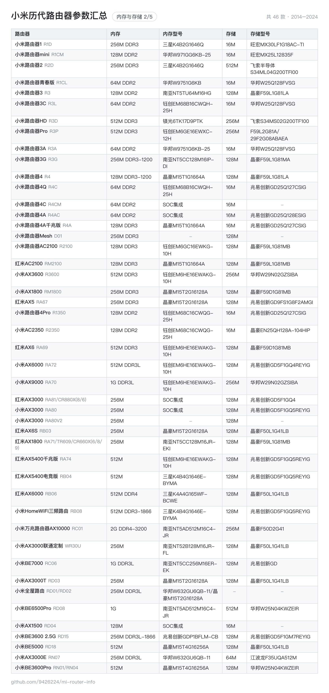
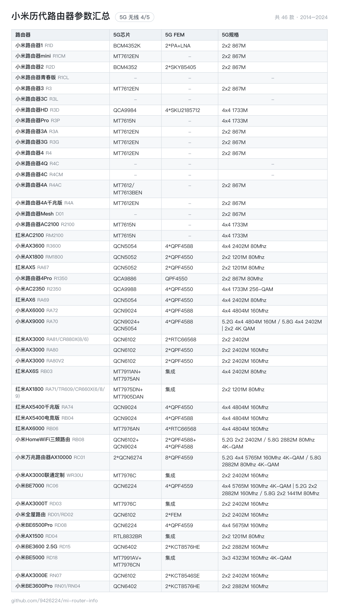

# 小米历代路由器参数汇总

小米 / 红米历代路由器硬件参数一览，从 2014 年的小米路由器 1 到最新的 Wi‑Fi 7 型号。

[](https://github.com/9426224/mi-router-info/actions/workflows/build.yml)

- 在线浏览（可搜索、排序、按列分组）：<https://9426224.github.io/mi-router-info/>
- 数据源：[`data/routers.csv`](data/routers.csv)

<!-- STATS:START -->

**46 款型号** · 上市时间 2014–2024 · 21 项参数 · 数据源 [`data/routers.csv`](data/routers.csv)
<!-- STATS:END -->

## 参数总览（图片版）

按用途分成五张图，均保留「名称 + 型号」作为索引列；点击图片可查看原图。

<!-- IMAGES:START -->

### 概览与性能


### 内存与存储



### 2.4G 无线


### 5G 无线



### 接口与其他


<!-- IMAGES:END -->

## 添加或修正型号

只需要改 [`data/routers.csv`](data/routers.csv) 的一行，推送后 GitHub Actions 会自动重新生成上面的图片、网页和统计。

1. 用 Excel / WPS / Numbers 打开 `data/routers.csv`（UTF-8 编码），或在 GitHub 网页上直接编辑。
2. 按表头填写一行，不确定的字段填 `-`。
3. 提交。CI 会校验列数、必填项和重复型号，然后重新生成 `assets/specs-*.png` 与 `output/index.html`。

字段含义、编辑方式和本地预览见 [docs/contributing.md](docs/contributing.md)。

## 本地构建

需要 Node.js 22 及以上：

```console
npm install
npx playwright install chromium
npm run build
```

构建会生成 `assets/specs-*.png` 和 `output/index.html`（浏览器直接打开即可预览），并把统计与图片写回本页。

- `npm run check`：检查格式
- `npm run fix`：自动修正格式

## 仓库结构

| 路径                 | 用途                             |
| -------------------- | -------------------------------- |
| `data/routers.csv`   | 唯一数据源，一行一台型号         |
| `scripts/build.mjs`  | 生成图片、网页并更新 README      |
| `web/`               | 网页模板、样式与前端脚本         |
| `assets/specs-*.png` | 自动生成的表格图片（勿手改）     |
| `output/`            | 构建产物，CI 部署到 GitHub Pages |
| `docs/`              | 设计与维护文档                   |

## 许可

本文档以 MIT 协议发布。详情请见 [LICENSE](LICENSE)。
