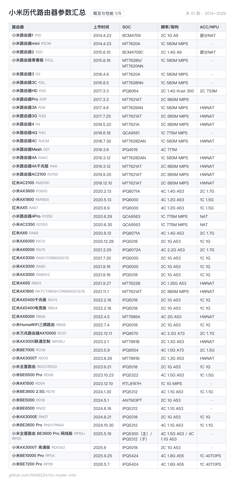
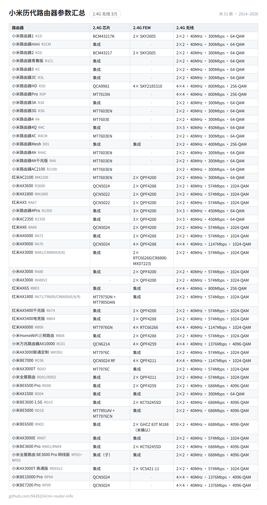
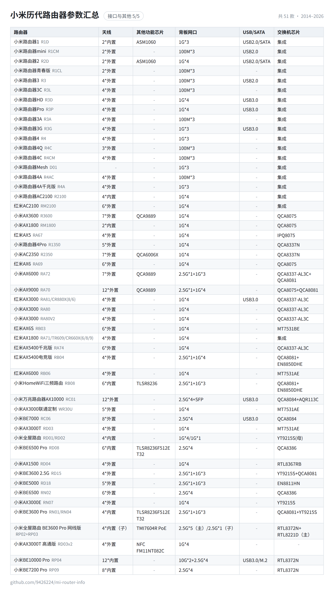

# 小米历代路由器参数汇总

小米、红米路由器（2014 年至今）的硬件参数整理：主控、内存、存储、无线芯片与 FEM、网口和扩展接口。数据来自拆机文章、官方规格和上市信息，逐条来源见 [docs/sources.md](docs/sources.md)。

- 在线表格（搜索、排序、按列分组）：<https://9426224.github.io/mi-router-info/>
- 数据文件：[`data/routers.csv`](data/routers.csv)
- 新增或修正型号只需要改 CSV 的一行，图片、网页和本页统计由 CI 重新生成

[](https://github.com/9426224/mi-router-info/actions/workflows/build.yml)

<!-- STATS:START -->

**51 款型号** · 上市时间 2014–2026 · 21 项参数 · 数据源 [`data/routers.csv`](data/routers.csv)
<!-- STATS:END -->

## 图片版

按用途分成五张，每张以「名称 + 型号」作为索引列，方便对照；点击图片查看原图。

<!-- IMAGES:START -->

### 概览与性能



### 内存与存储


### 2.4G 无线



### 5G 无线


### 接口与其他


<!-- IMAGES:END -->

## 字段说明

| 字段                             | 说明                                       |
| -------------------------------- | ------------------------------------------ |
| 路由器名称 / 型号                | 商品名 / 背板或认证型号，多型号用 `/` 分隔 |
| 上市时间                         | 开售或众筹日期；只查到月份时写作 `YYYY.M`  |
| SOC / 频率/架构                  | 主控芯片与核心数、主频、架构               |
| ACC/NPU                          | 硬件加速或 NPU 规格，`-` 表示没有或未确认  |
| 内存 / 内存型号                  | 容量、代际与颗粒型号                       |
| 存储 / 存储型号                  | 闪存容量与颗粒型号                         |
| 2.4G / 5G 芯片、FEM、规格        | 无线芯片、外置功放与理论速率（含 4K QAM）  |
| 天线 / 其他功能芯片              | 天线数量与内外置、蓝牙/NFC/PoE 等辅助芯片  |
| 背板网口 / USB/SATA / 交换机芯片 | 有线接口、存储接口与交换芯片               |

几条口径：

- `-` 表示该项未确认或不适用，不当成 0。
- 速率是厂商理论最大值，实际速率取决于终端、频宽和环境影响。
- 同一型号可能有多个硬件批次（例如 BE3600 的 RD15/RD16、AX3000T 的联发科/高通版、BE6500 Pro 的内存缩水版），表中记录主批次，差异单独整理在 [docs/variants.md](docs/variants.md)。

## 添加或修正型号

1. 用 Excel / WPS / Numbers 打开 `data/routers.csv`（UTF-8），或在 GitHub 网页上直接编辑。
2. 按表头补一行，未知字段填 `-`。
3. 提交后 CI 会校验列数、必填项和重复型号，重新生成 `assets/specs-*.png` 与 `output/index.html`。

字段约定和常见问题见 [docs/contributing.md](docs/contributing.md)。

## 本地构建

需要 Node.js 22 及以上：

```console
npm install
npx playwright install chromium
npm run build
```

构建会生成 `assets/specs-*.png` 和 `output/index.html`（浏览器直接打开预览），并更新本页的统计与图片。CI 会用统一字体重新渲染一遍，因此本地构建主要用于预览排版。

- `npm run check`：检查格式
- `npm run fix`：自动修正格式

## 许可

本文档以 MIT 协议发布。详情请见 [LICENSE](LICENSE)。
